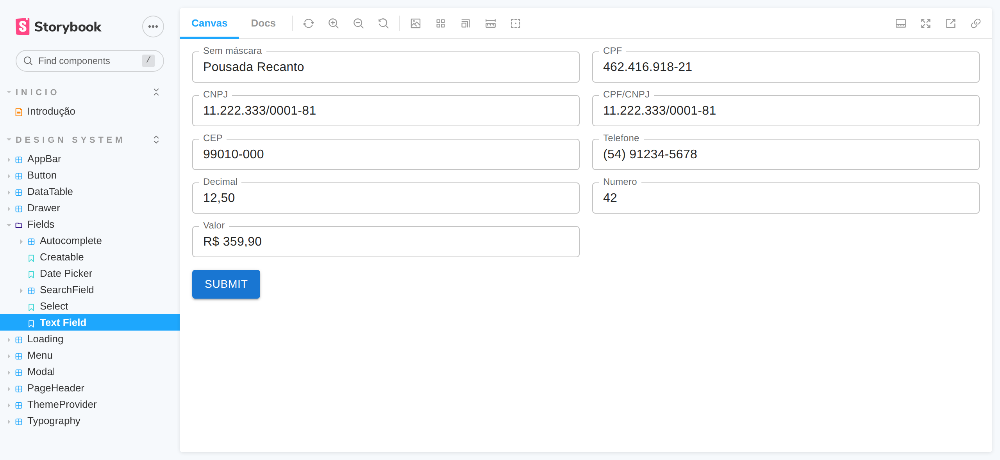
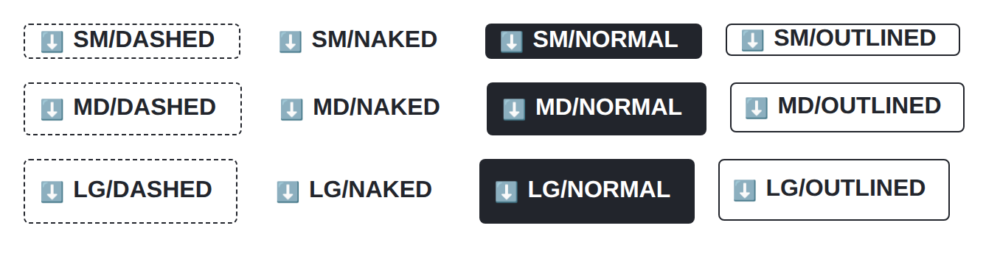
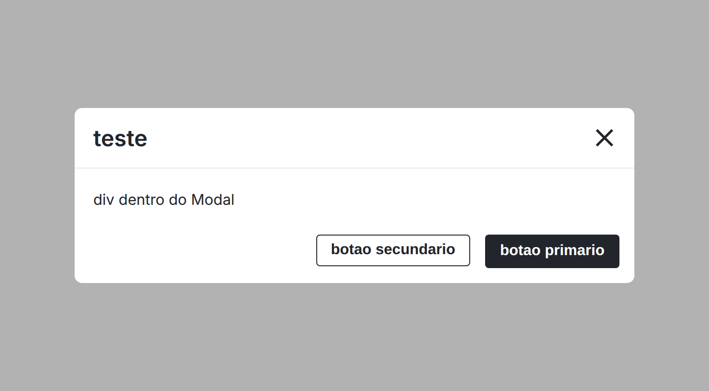
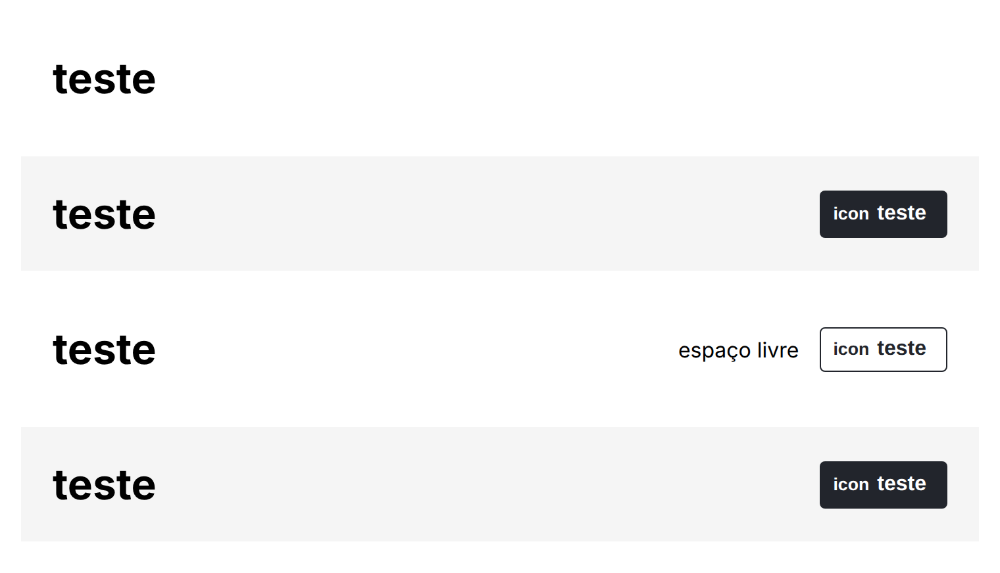
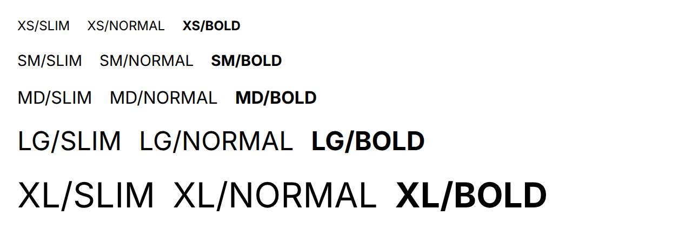

<div align="center">

# rm_monorepo

**A Lerna monorepo of React components (form fields with Brazilian masks, data table, modal, drawer, menu, page header and theme) that I published to npm as `@rm-monorepo/*` and used in Quarto Digital.**


[**Live Storybook**](https://raniellimontagna.github.io/rm_monorepo/) •
[Packages](#packages) •
[Screenshots](#screenshots) •
[Monorepo layout](#monorepo-layout) •
[Running locally](#running-locally) •
[History](#project-history)

</div>

> [!WARNING]
> **Discontinued.** rm_monorepo is no longer maintained and this repository is archived as a portfolio reference. The `@rm-monorepo/*` packages were removed from npm, so they can no longer be installed from the registry. The [Storybook](https://raniellimontagna.github.io/rm_monorepo/) is still online.



## About

In 2022 I kept rebuilding the same form fields, tables and dialogs in every React project, so I moved them into this monorepo as small packages. It started from [remarkablemark/lerna-template](https://github.com/remarkablemark/lerna-template). Every push to `production` ran commitlint, build, lint and tests, and Lerna published the changed packages to npm with versions taken from the conventional commits, plus a GitHub release for each one.

Its main consumer was [Quarto Digital](https://github.com/RanielliMontagna/app-quarto-digital), the hotel front-desk app I built as my final project at UPF: its dialogs, tables, page headers, drawer and form fields come from here. Like that app, the component props and theme keys are in Portuguese (`titulo`, `colunas`, `acoes`, `cores`, `fontes`).

## Packages

| Package | Last version | What it provides |
| --- | --- | --- |
| `@rm-monorepo/fields` | 1.6.6 | `Form` (a React Hook Form wrapper), `TextField` with CPF, CNPJ, CPF/CNPJ, CEP, phone, decimal, number and currency masks, `SearchField`, `Select`, `Autocomplete`, `Creatable` and `DatePicker`, all built on MUI 5 |
| `@rm-monorepo/data-table` | 1.1.1 | Table driven by a column list, with an actions menu per row |
| `@rm-monorepo/modal` | 1.2.6 | Dialog in three sizes with a title and optional primary, secondary and extra footer actions |
| `@rm-monorepo/drawer` | 1.1.4 | Side navigation with a header, items with icons and nested options |
| `@rm-monorepo/menu` | 1.5.3 | Dropdown menu on top of `@szhsin/react-menu` |
| `@rm-monorepo/page-header` | 1.1.5 | Page title with an action button and a free slot on the right |
| `@rm-monorepo/app-bar` | 1.2.0 | Top bar with left and right slots |
| `@rm-monorepo/button` | 1.3.7 | Four variants (normal, outlined, dashed, naked) in three sizes, with an optional icon |
| `@rm-monorepo/typography` | 1.3.4 | Text in five sizes and three weights |
| `@rm-monorepo/loading` | 1.3.1 | Full-screen loading overlay |
| `@rm-monorepo/theme-provider` | 1.4.4 | One provider for the styled-components theme (colors, font sizes, modal, menu and app bar colors) and a custom MUI theme |
| `@rm-monorepo/utils` | 1.3.3 | Masks and React Hook Form rules (required, e-mail, CPF, CNPJ, phone, length), `toRem` and color helpers |
| `@rm-monorepo/storybook` | 1.13.3 | The Storybook itself |

React, styled-components and, for the fields and drawer, MUI and React Hook Form are peer dependencies. Each package is compiled with `tsc` to CommonJS with type declarations.

## Screenshots

<table>
  <tr>
    <td width="50%"><p align="center"><sub><code>Button</code>: every variant and size</sub></p></td>
    <td width="50%"><p align="center"><sub><code>Modal</code> with footer actions</sub></p></td>
  </tr>
  <tr>
    <td width="50%"><p align="center"><sub><code>PageHeader</code> with a button and a free slot</sub></p></td>
    <td width="50%"><p align="center"><sub><code>Typography</code> sizes and weights</sub></p></td>
  </tr>
</table>

### In production: Quarto Digital

<table>
  <tr>
    <td width="50%"><p align="center"><sub><code>PageHeader</code>, <code>SearchField</code> and <code>DataTable</code> on the guests page</sub></p></td>
    <td width="50%"><p align="center"><sub><code>Modal</code>, <code>Creatable</code> and <code>TextField</code> in the new stay wizard</sub></p></td>
  </tr>
</table>

## Monorepo layout

```text
packages/
├── appBar/  button/  dataTable/  drawer/  fields/  loading/
├── menu/  modal/  pageHeader/  themeProvider/  typography/  utils/
└── storybook/            # Storybook 6.5 (webpack 4); stories import each package's source
templates/                # React and TypeScript package templates used by `yarn create-package`
scripts/create-package.ts
test/setupTests.ts        # jest-dom and jest-axe matchers shared by every package
.github/workflows/        # build (lint, test, Codecov) and publish (Lerna to npm), both disabled
```

## Tech stack

| Area | Tools |
| --- | --- |
| Components | React 18, TypeScript, styled-components, MUI 5, MUI X Date Pickers, React Hook Form, react-number-format, React Icons |
| Monorepo | Lerna 5 (independent versions), Yarn 1 workspaces |
| Release | Conventional Commits with commitlint, Lerna publish to npm and GitHub releases from GitHub Actions |
| Docs | Storybook 6.5, hosted on GitHub Pages |
| Quality | Jest, Testing Library, jest-axe, ESLint, Prettier, Husky, lint-staged |

## Running locally

Last checked in October 2026 on Node.js 24.

```bash
git clone https://github.com/RanielliMontagna/rm_monorepo.git
cd rm_monorepo
npx yarn@1 install --frozen-lockfile

npx yarn@1 test    # Jest
npx yarn@1 lint

# Storybook 6.5 runs on webpack 4, which needs the legacy OpenSSL provider on Node.js 17+
export NODE_OPTIONS=--openssl-legacy-provider
npx yarn@1 storybook   # http://localhost:6006
npx yarn@1 build       # tsc for every package, plus the static Storybook
```

The nine packages with tests (25 in total) keep 100% coverage; `fields`, `data-table` and `utils` have none. Packages that import a sibling's source (`button`, `data-table`, `fields`, `modal`, `page-header`, `typography`) compile to `lib/<package>/src` instead of `lib/`, so their `lib/index.js` is missing after a local build. The [Quarto Digital README](https://github.com/RanielliMontagna/app-quarto-digital#running-locally) shows how to pack them anyway.

## Project history

- **July 2022**: the monorepo starts from a Lerna template, with `typography` as the first package.
- **August 2022**: tests and Storybook, then `button`, `loading`, the first fields (text, number, currency, search, date picker), `page-header`, `modal`, `menu`, `drawer`, `data-table`, `app-bar` and the masks and rules in `utils`. Packages are published to npm on every push to `production`.
- **September 2022**: `select`, `autocomplete` and `creatable`, and a tighter React Hook Form integration.
- **October 2022**: masks move into `TextField`.
- **November 2022**: disabled buttons and a custom MUI theme in `ThemeProvider`. Last release on 10 November 2022, the same day as the final Quarto Digital commit.
- **March 2025**: Dependabot turned off.
- **October 2026**: archived. The publish and build workflows were disabled and the Storybook moved to GitHub Pages.

## License

[MIT](LICENSE)

## Author

Built by [Ranielli Montagna](https://github.com/RanielliMontagna) · [ranimontagna.com](https://ranimontagna.com). Based on [remarkablemark/lerna-template](https://github.com/remarkablemark/lerna-template).
